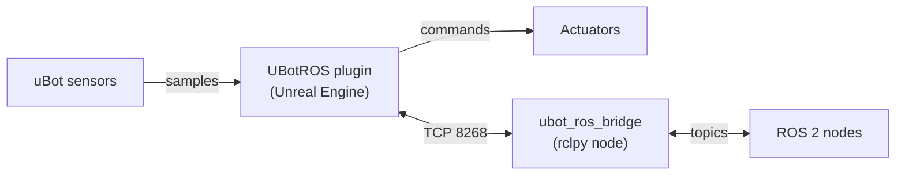

<p align="center">
  <picture>
    <source media="(prefers-color-scheme: dark)" srcset="docs/brand/ubot-mark-light.svg">
    <source media="(prefers-color-scheme: light)" srcset="docs/brand/ubot-mark-dark.svg">
    
  </picture>
</p>
<h1 align="center">uBot ROS</h1>
<p align="center"><b>Connect Unreal Engine to ROS 2: sensors, TF, /clock and cmd_vel over a TCP bridge.</b></p>
<p align="center">
  <a href="https://github.com/AstreoX/uBotROS/releases"></a>
  <a href="LICENSE"></a>
  
</p>
<p align="center">
  <a href="https://astreox.github.io/uBotDocs/ros/">Documentation</a> ·
  <a href="https://github.com/AstreoX/uBotROS/releases">Releases</a> ·
  <a href="https://github.com/users/AstreoX/projects/2">Roadmap</a> ·
  <a href="https://github.com/AstreoX/uBotROS/issues">Issues</a>
</p>

**English** | [简体中文](README.zh-CN.md)

## What it is

uBot ROS is the beta ROS 2 adapter of the [uBot family](#ubot-family) for Unreal Engine 5.5. It publishes uBot sensors, TF and the simulation clock to ROS 2 and delivers the velocity, attitude and motor commands that arrive from ROS 2 to Actors.

- **No third-party dependencies in Unreal.** The plugin encodes ROS 2 CDR itself; rclcpp and TempoROS are not required.
- **Separate systems.** One TCP connection (port 8268) joins Unreal and ROS 2, for example UE on Windows and ROS 2 in WSL.
- **Seven sensor types.** Pose, odometry, IMU, 2D and 3D lidar, RGB and depth cameras, stamped with simulation time.
- **Commands from ROS 2.** `cmd_vel` goes to any Actor or component that implements the uBot velocity interface; attitude and motor commands go to drones.
- **Automatic reconnect.** After a lost connection the plugin retries and registers its topics again.



`<ns>` is the robot namespace: the `Namespace` of its `uBot Identity` component, otherwise the Actor name.

| Topic | Message type | Direction |
| --- | --- | --- |
| `/<ns>/pose`, `/<ns>/odom` | `geometry_msgs/msg/PoseStamped`, `nav_msgs/msg/Odometry` | UE → ROS 2 |
| `/<ns>/imu/data` | `sensor_msgs/msg/Imu` | UE → ROS 2 |
| `/<ns>/scan`, `/<ns>/lidar/points` | `sensor_msgs/msg/LaserScan`, `sensor_msgs/msg/PointCloud2` | UE → ROS 2 |
| `/<ns>/camera/{color,depth}/{image_raw,camera_info}` | `sensor_msgs/msg/Image`, `sensor_msgs/msg/CameraInfo` | UE → ROS 2 |
| `/tf`, `/tf_static`, `/clock` | `tf2_msgs/msg/TFMessage`, `rosgraph_msgs/msg/Clock` | UE → ROS 2 |
| `/<ns>/cmd_vel` | `geometry_msgs/msg/Twist` | ROS 2 → UE |
| `/<ns>/cmd_attitude`, `/<ns>/cmd_motors` | `mavros_msgs/msg/AttitudeTarget`, `actuator_msgs/msg/Actuators` | ROS 2 → UE |

## Install

**Recommended: uBot Manager.** Download the installer from the [uBotManager releases](https://github.com/AstreoX/uBotManager/releases), open the `.uproject` and apply the **ROS 2 Sensors** recipe. The recipe installs and enables UBotCore, UBotSensor and uBot ROS; see [Install uBot](https://astreox.github.io/uBotDocs/start/install/).

**Manual:** install UBotCore and UBotSensor first, then clone this repository next to them and enable **uBot ROS** in `Edit > Plugins`. The plugin compiles from source and needs a C++ project.

```bash
git clone -b v0.1.2 https://github.com/AstreoX/uBotROS.git <Project>/Plugins/uBot/uBotROS
```

**Requirements:** Unreal Engine 5.5 (Windows), UBotCore `^0.1.2`, UBotSensor `^0.1.0`; ROS 2 Humble (Ubuntu 22.04) with `rclpy` for the bridge.

## Quick start

1. Start the bridge on the ROS 2 side (Ubuntu 22.04 or WSL):

   ```bash
   source /opt/ros/humble/setup.bash
   cd <Project>/Plugins/uBot/uBotROS/ros2/ubot_ros_bridge
   python3 -m ubot_ros_bridge.bridge_node --port 8268
   ```

2. Press **Play** in Unreal Editor. The plugin connects to `127.0.0.1:8268` and publishes `/clock`.
3. In a second ROS 2 terminal, run `ros2 topic echo /clock --once`.

To publish sensors, add uBot sensor components and **uBot ROS Sensor Bridge** to an Actor. The bridge listens on all interfaces without authentication or encryption; on untrusted networks start it with `--bind-address 127.0.0.1`.

## Documentation

The documentation site and `docs/` are in Chinese; [docs/PROTOCOL.md](docs/PROTOCOL.md) is in English.

| I want to ... | Go to |
| --- | --- |
| set up the ROS 2 side and check the connection | [Prepare the ROS 2 side](https://astreox.github.io/uBotDocs/ros/ros2-setup/) |
| publish sensors, TF and `/clock` | [Publish sensors](https://astreox.github.io/uBotDocs/ros/publish-sensors/), [TF and /clock](https://astreox.github.io/uBotDocs/ros/tf-and-clock/) |
| drive an Actor with `cmd_vel` | [Receive cmd_vel](https://astreox.github.io/uBotDocs/ros/cmd-vel/) |
| control a drone from ROS 2 | [Flight commands](https://astreox.github.io/uBotDocs/ros/flight-commands/) |
| troubleshoot the connection | [Connection and status](https://astreox.github.io/uBotDocs/ros/connection/) |
| publish a custom sensor | [Add a ROS publisher](https://astreox.github.io/uBotDocs/develop/ros-publisher/) |
| migrate from the old ROS plugins | [Migration](https://astreox.github.io/uBotDocs/develop/migration/), [docs/MIGRATION.md](docs/MIGRATION.md) |
| read the protocol and design notes | [docs/PROTOCOL.md](docs/PROTOCOL.md), [docs/ARCHITECTURE.md](docs/ARCHITECTURE.md), [docs/PERFORMANCE.md](docs/PERFORMANCE.md) |

## uBot family

| Repository | What it is |
| --- | --- |
| [uBotCore](https://github.com/AstreoX/uBotCore) | Simulation clock, frame header, shared interfaces, package management |
| [uBotSensor](https://github.com/AstreoX/uBotSensor) | Pose, IMU, odometry, 2D/3D lidar, RGB and depth cameras |
| **[uBotROS](https://github.com/AstreoX/uBotROS)** | **ROS 2 over a TCP bridge: sensors, TF, /clock, cmd_vel** |
| [uBotAerial](https://github.com/AstreoX/uBotAerial) | Multirotor drones: simplified flight, rigid-body dynamics, wind |
| [uBotManager](https://github.com/AstreoX/uBotManager) | Desktop app and CLI to install, update and build uBot packages |
| [uBotDocs](https://github.com/AstreoX/uBotDocs) | Documentation site: https://astreox.github.io/uBotDocs/ |

## Development

- Build: place the plugin in `<Project>/Plugins/uBot/uBotROS` of a UE 5.5 project that has UBotCore and UBotSensor, then build the project.
- Test: UE automation tests (`UBotROS.*`) and the bridge's Python tests; see [docs/TESTING.md](docs/TESTING.md).
- A protocol change updates the specification, the UE side and the bridge together; see [docs/PROTOCOL.md](docs/PROTOCOL.md).
- Report issues in [Issues](https://github.com/AstreoX/uBotROS/issues).

## License

Apache-2.0, see [LICENSE](LICENSE) and [NOTICE](NOTICE). Copyright 2026 AstreoX.
