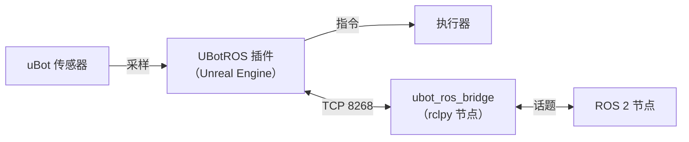

<p align="center">
  <picture>
    <source media="(prefers-color-scheme: dark)" srcset="docs/brand/ubot-mark-light.svg">
    <source media="(prefers-color-scheme: light)" srcset="docs/brand/ubot-mark-dark.svg">
    
  </picture>
</p>
<h1 align="center">uBot ROS</h1>
<p align="center"><b>把 Unreal Engine 接入 ROS 2：通过 TCP 桥传输传感器、TF、/clock 和 cmd_vel。</b></p>
<p align="center">
  <a href="https://github.com/AstreoX/uBotROS/releases"></a>
  <a href="LICENSE"></a>
  
</p>
<p align="center">
  <a href="https://astreox.github.io/uBotDocs/ros/">文档</a> ·
  <a href="https://github.com/AstreoX/uBotROS/releases">发布版本</a> ·
  <a href="https://github.com/users/AstreoX/projects/2">路线图</a> ·
  <a href="https://github.com/AstreoX/uBotROS/issues">问题反馈</a>
</p>

[English](README.md) | **简体中文**

## 简介

uBot ROS 是 [uBot 系列](#ubot-系列)中面向 Unreal Engine 5.5 的 ROS 2 适配器（Beta）。它把 uBot 传感器、TF 和仿真时钟发布到 ROS 2，并把 ROS 2 发来的速度、姿态和电机指令交给 Actor。

- **UE 侧没有第三方依赖。** 插件自行编码 ROS 2 CDR，不需要 rclcpp 和 TempoROS。
- **可分处不同系统。** UE 与 ROS 2 之间只有一条 TCP 连接（端口 8268），例如 UE 运行在 Windows，ROS 2 运行在 WSL。
- **七种传感器。** 位姿、里程计、IMU、2D / 3D 激光雷达、RGB 与深度相机，时间戳取仿真时间。
- **来自 ROS 2 的指令。** `cmd_vel` 交给实现了 uBot 速度接口的 Actor 或组件，姿态和电机指令交给无人机。
- **自动重连。** 连接断开后，插件重试并重新注册全部话题。



`<ns>` 是机器人的命名空间：优先取 `uBot Identity` 组件的 `Namespace`，否则取 Actor 名。

| 话题 | 消息类型 | 方向 |
| --- | --- | --- |
| `/<ns>/pose`、`/<ns>/odom` | `geometry_msgs/msg/PoseStamped`、`nav_msgs/msg/Odometry` | UE → ROS 2 |
| `/<ns>/imu/data` | `sensor_msgs/msg/Imu` | UE → ROS 2 |
| `/<ns>/scan`、`/<ns>/lidar/points` | `sensor_msgs/msg/LaserScan`、`sensor_msgs/msg/PointCloud2` | UE → ROS 2 |
| `/<ns>/camera/{color,depth}/{image_raw,camera_info}` | `sensor_msgs/msg/Image`、`sensor_msgs/msg/CameraInfo` | UE → ROS 2 |
| `/tf`、`/tf_static`、`/clock` | `tf2_msgs/msg/TFMessage`、`rosgraph_msgs/msg/Clock` | UE → ROS 2 |
| `/<ns>/cmd_vel` | `geometry_msgs/msg/Twist` | ROS 2 → UE |
| `/<ns>/cmd_attitude`、`/<ns>/cmd_motors` | `mavros_msgs/msg/AttitudeTarget`、`actuator_msgs/msg/Actuators` | ROS 2 → UE |

## 安装

**推荐：uBot Manager。** 从 [uBotManager 的 Releases](https://github.com/AstreoX/uBotManager/releases) 下载安装包，打开工程的 `.uproject`，应用「ROS 2 传感器」组合（Recipe）。该组合会安装并启用 UBotCore、UBotSensor 和 uBot ROS，步骤见[安装 uBot](https://astreox.github.io/uBotDocs/start/install/)。

**手动安装：** 先安装 UBotCore 和 UBotSensor，再把本仓库克隆到它们旁边，并在 `Edit > Plugins` 中启用 **uBot ROS**。插件从源码编译，需要 C++ 工程。

```bash
git clone -b v0.1.2 https://github.com/AstreoX/uBotROS.git <Project>/Plugins/uBot/uBotROS
```

**要求：** Unreal Engine 5.5（Windows）、UBotCore `^0.1.2`、UBotSensor `^0.1.0`；桥端需要 ROS 2 Humble（Ubuntu 22.04）和 `rclpy`。

## 快速开始

1. 在 ROS 2 一侧（Ubuntu 22.04 或 WSL）启动桥：

   ```bash
   source /opt/ros/humble/setup.bash
   cd <Project>/Plugins/uBot/uBotROS/ros2/ubot_ros_bridge
   python3 -m ubot_ros_bridge.bridge_node --port 8268
   ```

2. 在 Unreal Editor 里点击 **Play**。插件会连接 `127.0.0.1:8268` 并发布 `/clock`。
3. 在另一个 ROS 2 终端里运行 `ros2 topic echo /clock --once`。

要发布传感器，请给 Actor 添加 uBot 传感器组件和 **uBot ROS Sensor Bridge**。桥默认监听所有网卡，没有认证和加密；在不可信的网络里，请用 `--bind-address 127.0.0.1` 启动。

## 文档

文档站和 `docs/` 是中文，[docs/PROTOCOL.md](docs/PROTOCOL.md) 是英文。

| 我想… | 前往 |
| --- | --- |
| 准备 ROS 2 端并确认连通 | [准备 ROS 2 端](https://astreox.github.io/uBotDocs/ros/ros2-setup/) |
| 发布传感器、TF 和 `/clock` | [发布传感器数据](https://astreox.github.io/uBotDocs/ros/publish-sensors/)、[TF 与 /clock](https://astreox.github.io/uBotDocs/ros/tf-and-clock/) |
| 用 `cmd_vel` 驱动 Actor | [接收 cmd_vel](https://astreox.github.io/uBotDocs/ros/cmd-vel/) |
| 从 ROS 2 控制无人机 | [从 ROS 2 发飞行指令](https://astreox.github.io/uBotDocs/ros/flight-commands/) |
| 排查连接问题 | [连接与状态](https://astreox.github.io/uBotDocs/ros/connection/) |
| 发布自定义传感器 | [为自定义传感器添加 ROS 发布器](https://astreox.github.io/uBotDocs/develop/ros-publisher/) |
| 从旧的 ROS 插件迁移 | [从旧插件迁移](https://astreox.github.io/uBotDocs/develop/migration/)、[docs/MIGRATION.md](docs/MIGRATION.md) |
| 了解协议和设计 | [docs/PROTOCOL.md](docs/PROTOCOL.md)、[docs/ARCHITECTURE.md](docs/ARCHITECTURE.md)、[docs/PERFORMANCE.md](docs/PERFORMANCE.md) |

## uBot 系列

| 仓库 | 说明 |
| --- | --- |
| [uBotCore](https://github.com/AstreoX/uBotCore) | 仿真时钟、帧头、共享接口、插件管理 |
| [uBotSensor](https://github.com/AstreoX/uBotSensor) | 位姿、IMU、里程计、2D/3D 激光雷达、RGB 与深度相机 |
| **[uBotROS](https://github.com/AstreoX/uBotROS)** | **通过 TCP 桥接入 ROS 2：传感器、TF、/clock、cmd_vel** |
| [uBotAerial](https://github.com/AstreoX/uBotAerial) | 多旋翼无人机：简化飞行、刚体动力学、风 |
| [uBotManager](https://github.com/AstreoX/uBotManager) | 在 UE 工程里安装、更新、构建 uBot 包的桌面程序和命令行 |
| [uBotDocs](https://github.com/AstreoX/uBotDocs) | 文档站：https://astreox.github.io/uBotDocs/ |

## 开发

- 构建：把插件放进装有 UBotCore 和 UBotSensor 的 UE 5.5 工程的 `<Project>/Plugins/uBot/uBotROS`，然后编译工程。
- 测试：UE 自动化测试（`UBotROS.*`）和桥的 Python 测试，见 [docs/TESTING.md](docs/TESTING.md)。
- 修改协议时，规范、UE 端和桥一并修改，见 [docs/PROTOCOL.md](docs/PROTOCOL.md)。
- 问题请提交到 [Issues](https://github.com/AstreoX/uBotROS/issues)。

## 许可证

Apache-2.0，见 [LICENSE](LICENSE) 和 [NOTICE](NOTICE)。Copyright 2026 AstreoX。
